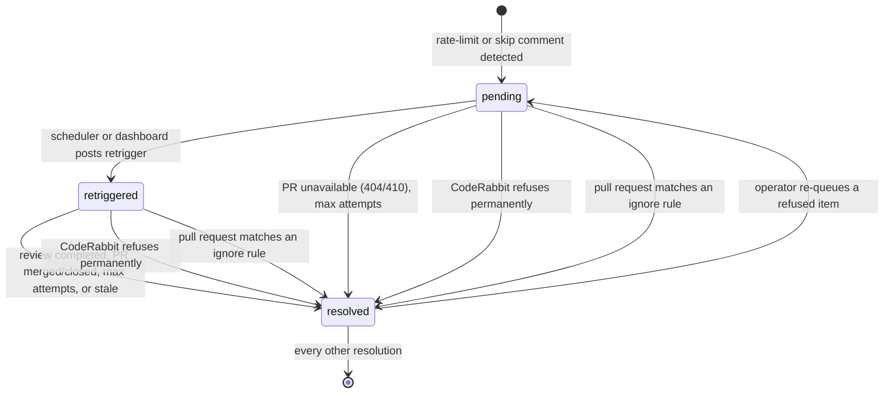

# Queue Status

State diagram and resolution reasons for the `QueueStatus` values. For authoritative behavior, read the source: [`QueueStatus`](../src/QueueStatus.ts), [`Resolution`](../src/Resolution.ts), [`queueRepository.enqueue()`](../src/db/queueRepository.ts), [`queueOrderRepository`](../src/db/queueOrderRepository.ts).

Resolution reasons:

- `review_completed` — CodeRabbit completed a review after the request.
- `manual_review` — a human marked the item reviewed from the dashboard.
- `pr_merged` / `pr_closed_without_merge` — the PR left the open state.
- `failed` — max trigger attempts reached, terminal HTTP failure, or the retriggered item went stale.
- `skipped` — CodeRabbit re-skipped the review after the request.
- `stale_comment` — the source comment is gone and no replacement exists.
- `permanently_refused` — CodeRabbit refused the review for a cause only an organization administrator can clear, such as a missing review seat. The item never reopens on its own, and the PR leaves the recovery path until an operator re-queues it.
- `excluded` — an ignore rule matched the PR author's login or the PR title, so the operator left the PR out of monitoring.

`permanently_refused` is not reopenable. An operator returns the item to `pending` through the dashboard re-queue action after clearing the refusal cause; the item gets a fresh attempt budget and rejoins the queue order.

`excluded` is reopenable. Nothing is stored on the pull request row, so removing the rule clears the match at the next detection; a source comment that changes after the resolution then reopens the item as `pending`.

`EFFECTIVE_ORDER_STATUSES` includes both `pending` and `retriggered` — both appear in Queue Order. When a new rate-limit comment arrives on a `retriggered` item, the source comment is updated in place; no new item is created. When the same comment is re-edited with a new CodeRabbit Run ID, the item's run tracking is updated in place and the retrigger clock restarts; no new item is created and no new retrigger comment is posted.
