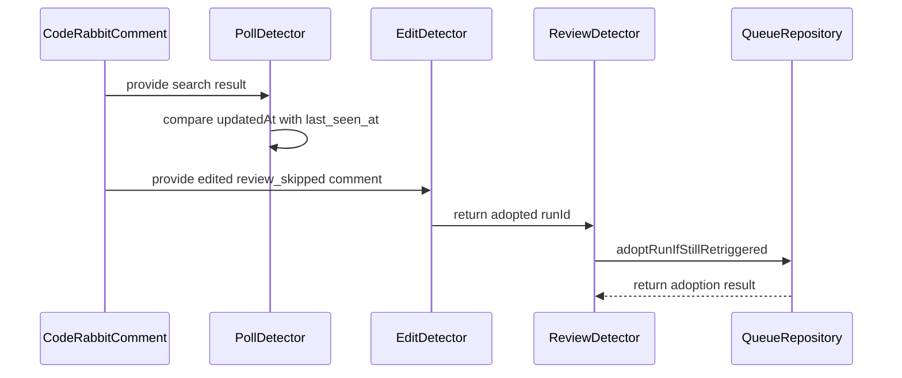

<!-- This is an auto-generated comment: review paused by coderabbit.ai -->

> [!NOTE]
> ## Reviews paused
> 
> Use the following commands to manage reviews:
> - `@coderabbitai resume` to resume automatic reviews.
> - `@coderabbitai review` to trigger a single review.
> 
> Use the checkboxes below for quick actions:
> - [ ] <!-- {"checkboxId":"7f6cc2e2-2e4e-497a-8c31-c9e4573e93d1"} --> ▶️ Resume reviews
> - [ ] <!-- {"checkboxId":"e9bb8d72-00e8-4f67-9cb2-caf3b22574fe"} --> 🔍 Trigger review

<!-- end of auto-generated comment: review paused by coderabbit.ai -->
<!-- This is an auto-generated comment: summarize by coderabbit.ai -->
<!-- review_stack_entry_start -->

<!-- review_stack_entry_end -->
<!-- recent_review_start -->

No actionable comments were generated in the recent review. 🎉

ℹ️ Recent review info

⚙️ Run configuration

**Configuration used**: Path: .coderabbit.yaml

**Review profile**: CHILL

**Plan**: Pro Plus

**Run ID**: `599a9952-cfe6-4029-b5bb-85c238e8be6c`

📥 Commits

Reviewing files that changed from the base of the PR and between ab08460d7fa2537c20e9555f4786a170e3c031c4 and 1bf2461e76954ef48ad478a00442ccd9beda1488.

📒 Files selected for processing (3)

* `src/probes/ReviewDetectorProbe.ts`
* `tests/detectorPoll.test.ts`
* `tests/probes/reviewDetectorProbe.test.ts`

🚧 Files skipped from review as they are similar to previous changes (2)

* tests/detectorPoll.test.ts
* src/probes/ReviewDetectorProbe.ts

**Included review availability:** Your plan provides up to 1 included review per hour; 0 remain after this review.

---

<!-- recent_review_end -->
<!-- walkthrough_start -->

📝 Walkthrough

## Walkthrough

The poller now ignores unchanged comments. Edited `review_skipped` comments with new run IDs are adopted without resolving the queue item. Conditional repository updates handle adoption races. Tests and business-rule anchors document the behavior.

### Changes

**Skip Comment Lifecycle**

|Layer / File(s)|Summary|
|---|---|
|**Comment freshness gate**   `src/detectorPoll.ts`, `tests/detectorPoll.test.ts`|`PollDetector` compares comment updates with `last_seen_at` before detection. Tests cover unchanged and newer comments.|
|**Retriggered run adoption**   `src/types/EditDetectionOutcome.ts`, `src/EditDetector.ts`, `src/ReviewDetector.ts`, `src/db/queueRepository.ts`, `src/probes/ReviewDetectorProbe.ts`, `tests/EditDetector.test.ts`, `tests/ReviewDetector.test.ts`, `tests/db/queueRepository.test.ts`, `tests/helpers/*`, `tests/probes/reviewDetectorProbe.test.ts`|A changed run ID produces an `adopted` outcome. The queue repository updates the run only while the item remains retriggered. Probe events and race handling cover both outcomes.|
|**Business-rule anchors and lifecycle documentation**   `docs/business-rules.md`, `.markdownlint-cli2.yaml`|Business-rule headings and table-of-contents links use stable anchors. The freshness and skip-comment rules describe the updated flow. Markdownlint permits the required inline anchors.|

**Estimated code review effort:** 3 (Moderate) | ~20 minutes

<!-- final_review_risk_start -->
**Merge Risk:** _⚪ Minimal_ · up to `1bf24`

The PR updates skip-comment re-edit handling and prevents repeated skip events; no actionable merge-blocking risk remains beyond normal checks and review.
<!-- final_review_risk_end -->

### Sequence Diagram(s)

<!-- walkthrough_end -->
<!-- pre_merge_checks_walkthrough_start -->

🚥 Pre-merge checks | ✅ 5

✅ Passed checks (5 passed)

|         Check name         | Status   | Explanation                                                                                                                                                                                               |
| :------------------------: | :------- | :-------------------------------------------------------------------------------------------------------------------------------------------------------------------------------------------------------- |
|      Description Check     | ✅ Passed | Check skipped - CodeRabbit’s high-level summary is enabled.                                                                                                                                               |
|         Title check        | ✅ Passed | The title clearly summarizes the two primary fixes: skip-comment re-edit resolution and repeated event emission.                                                                                          |
|     Linked Issues check    | ✅ Passed | The changes satisfy issue `#315`. They add freshness gating for search results, adopt changed CodeRabbit run IDs while retaining retriggered status, resolve unchanged runs as Skipped, preserve cleared-r… |
| Out of Scope Changes check | ✅ Passed | The changes remain within issue `#315`. The documentation, configuration, implementation, probes, mocks, and tests directly support the skip-comment adoption and freshness-gating fixes.                   |
|     Docstring Coverage     | ✅ Passed | No functions found in the changed files to evaluate docstring coverage. Skipping docstring coverage check. Docstring coverage is scoped to functions touched by this diff. Analyzed 0 functions across 1… |

Full details: Linked Issues check

**Explanation**

The changes satisfy issue `#315`. They add freshness gating for search results, adopt changed CodeRabbit run IDs while retaining retriggered status, resolve unchanged runs as Skipped, preserve cleared-run behavior, and add status-guarded adoption with race handling and tests.

Full details: Docstring Coverage

**Explanation**

No functions found in the changed files to evaluate docstring coverage. Skipping docstring coverage check. Docstring coverage is scoped to functions touched by this diff. Analyzed 0 functions across 13 files.

<!-- pre_merge_checks_walkthrough_end -->
<!-- finishing_touch_checkbox_start -->

✨ Finishing Touches

📝 Generate docstrings

- [ ] <!-- {"checkboxId":"7962f53c-55bc-4827-bfbf-6a18da830691"} --> Create stacked PR
- [ ] <!-- {"checkboxId":"3e1879ae-f29b-4d0d-8e06-d12b7ba33d98"} --> Commit on current branch

🧪 Generate unit tests (beta)

- [ ] <!-- {"checkboxId": "f47ac10b-58cc-4372-a567-0e02b2c3d479", "radioGroupId": "utg-output-choice-group-5404798734"} -->   Create PR with unit tests
- [ ] <!-- {"checkboxId": "6ba7b810-9dad-11d1-80b4-00c04fd430c8", "radioGroupId": "utg-output-choice-group-5404798734"} -->   Commit unit tests in branch `issues/315`

<!-- finishing_touch_checkbox_end -->
<!-- tips_start -->

---

Thanks for using [CodeRabbit](https://coderabbit.ai?utm_source=oss&utm_medium=github&utm_campaign=couimet/rabbit-maximizer&utm_content=320)! It's free for OSS, and your support helps us grow. If you like it, consider giving us a shout-out.

❤️ Share

- [X](https://twitter.com/intent/tweet?text=I%20just%20used%20%40coderabbitai%20for%20my%20code%20review%2C%20and%20it%27s%20fantastic%21%20It%27s%20free%20for%20OSS%20and%20offers%20a%20free%20trial%20for%20the%20proprietary%20code.%20Check%20it%20out%3A&url=https%3A//coderabbit.ai)
- [Mastodon](https://mastodon.social/share?text=I%20just%20used%20%40coderabbitai%20for%20my%20code%20review%2C%20and%20it%27s%20fantastic%21%20It%27s%20free%20for%20OSS%20and%20offers%20a%20free%20trial%20for%20the%20proprietary%20code.%20Check%20it%20out%3A%20https%3A%2F%2Fcoderabbit.ai)
- [Reddit](https://www.reddit.com/submit?title=Great%20tool%20for%20code%20review%20-%20CodeRabbit&text=I%20just%20used%20CodeRabbit%20for%20my%20code%20review%2C%20and%20it%27s%20fantastic%21%20It%27s%20free%20for%20OSS%20and%20offers%20a%20free%20trial%20for%20proprietary%20code.%20Check%20it%20out%3A%20https%3A//coderabbit.ai)
- [LinkedIn](https://www.linkedin.com/sharing/share-offsite/?url=https%3A%2F%2Fcoderabbit.ai&mini=true&title=Great%20tool%20for%20code%20review%20-%20CodeRabbit&summary=I%20just%20used%20CodeRabbit%20for%20my%20code%20review%2C%20and%20it%27s%20fantastic%21%20It%27s%20free%20for%20OSS%20and%20offers%20a%20free%20trial%20for%20proprietary%20code)

Comment `@coderabbitai help` to get the list of available commands.

<!-- tips_end -->
